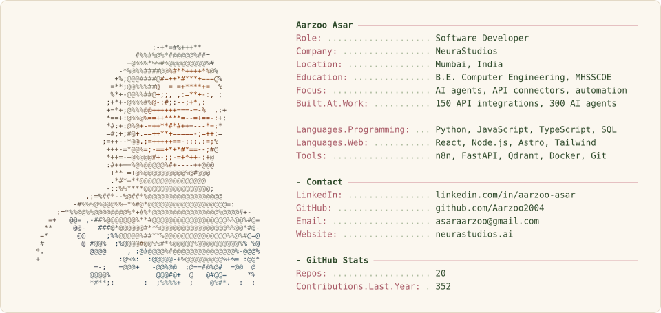
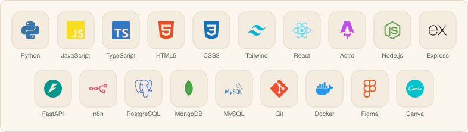

<picture>
  <source media="(prefers-color-scheme: dark)" srcset="assets/card2-dark.svg">
  
</picture>

## 🛠️ Technologies & Tools

<picture>
  <source media="(prefers-color-scheme: dark)" srcset="assets/tech-dark.svg">
  
</picture>

##  Find Me

