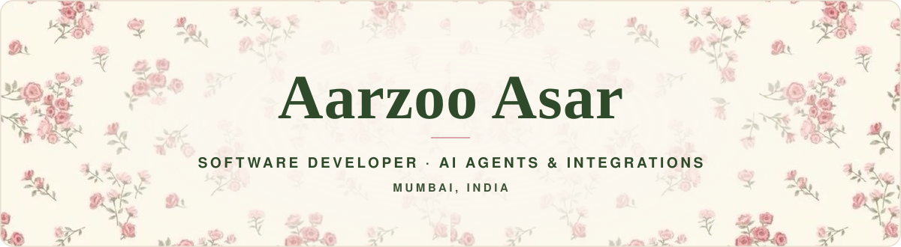
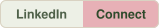
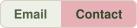



  

  
  
  
  

  
  
  

## ✿ About Me

I'm Aarzoo, a **Software Developer at Neura Studios** in Mumbai, with a **B.E. in Computer Engineering** from MHSSCOE.

I enjoy building the careful plumbing behind AI agents: **API connectors, guardrails and human-in-the-loop approval gates**, so automation stays reliable and safe to trust. At work I've built **150 API integrations** and **300 AI agents**, along with the company website.

Outside work I build small projects, from RAG chat over Google Drive files to n8n workflows that triage failed CI runs, and I like writing clear documentation as I go.

